 

## 👤 About Me

<table>
<tr>
<td align="center" width="260">
  
</td>
<td>

**🥷 Neetesh Singh Rajpoot**

- 🔭 Building clean, fast, and responsive web experiences
- 🌱 Currently learning **React, Node.js, and System Design**
- 👯 Open to **open-source and freelance** collaboration
- 💬 Ask me about **Web Development, JavaScript, and DSA**
- 📫 **neetesh.official01@gmail.com**

</td>
</tr>
</table>

---

## 🔦 Tech Stack

  
  
  
  
  
  

---

## 📊 GitHub Stats

  
  

---

## 🍥 Featured Projects

<table>
<tr><th>Project</th><th>Description</th><th>Tech</th></tr>
<tr>
  <td><a href="https://github.com/YOUR_USERNAME/project-1"><b>Project One</b></a></td>
  <td>Interactive modern web app</td>
  <td><code>JavaScript</code> <code>CSS</code></td>
</tr>
<tr>
  <td><a href="https://github.com/YOUR_USERNAME/project-2"><b>Project Two</b></a></td>
  <td>Full-stack app with REST API</td>
  <td><code>React</code> <code>Node.js</code></td>
</tr>
<tr>
  <td><a href="https://github.com/YOUR_USERNAME/project-3"><b>Project Three</b></a></td>
  <td>Responsive landing page</td>
  <td><code>HTML</code> <code>CSS</code></td>
</tr>
</table>

  <a href="https://github.com/YOUR_USERNAME?tab=repositories"><b>→ View all repositories</b></a>

---

## 🌃 My Contribution Village

  

<i>Every commit adds a building. Updated automatically every day.</i>

---

## 🌐 Connect With Me

  
  
  
  

  

<b>Keep coding, keep growing. 🚀</b>

